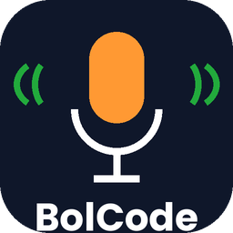

<p align="center"></p>

# BolCode: *Bolo, code ho jayega*

Edit code by **speaking** in Hinglish, Hindi or Gujarati. BolCode is a VS Code extension built on
**Gnani AI's Prisma** (speech to text) and **Timbre** (text to speech), made for developers who think in
their own language but write code in English.

> Built for the Great Indian AI Internship Challenge with Gnani AI.
> #GnaniAI #GreatIndianAIInternshipChallenge

<!-- Add the demo GIF here after filming:  -->

## What it does

Select some code, press **Ctrl+Alt+B** (Cmd+Alt+B on macOS), speak, press it again.

| You say | BolCode does |
|---|---|
| "is function ko async bana do aur error handling add karo" | Edits the selected code and shows a **diff** to accept or reject |
| "variable ka naam badal ke userId karo" | Renames it |
| "ye code samjhao" / "function su kare che samjavo" | Explains the code in simple Hinglish (and speaks a one-line Hindi summary) |
| "wapas karo" / "undo" / "pachhu karo" | Undoes the last change |

Nothing is applied until you accept the diff.

## How it works

```
hotkey -> ffmpeg records the mic -> Gnani Prisma (speech to text)
  -> Hinglish transcript -> intent (edit / explain / undo)
  -> LLM edits the selected code -> diff view -> Accept / Reject
  -> Gnani Timbre speaks a short reply
```

- **Prisma** handles Hindi-English mixed speech (`en-IN`), Hindi, Gujarati and more. A word-boost list helps it catch
  code terms like *async*, *useState*, *promise* (`src/vocab.ts`).
- **Timbre** speaks short Hindi confirmations and summaries (beta).
- The editing model is any **OpenAI-compatible** endpoint (set in settings), so you can point it at a hosted model
  or at your own server running an open model such as Gnani's Evon.

## Install

**Requirements:** VS Code 1.85+, [ffmpeg](https://ffmpeg.org) (used to record the microphone), a Gnani API key
(app.gnani.ai), and an API key for an OpenAI-compatible LLM.

**Option A, from the release file:** download `bolcode-0.1.0.vsix` from the Releases page, then in VS Code open the
Extensions panel, click `...` and choose **Install from VSIX...**.

**Option B, from source:**
```
git clone https://github.com/DevAnas19/bolcode.git
cd bolcode
npm install
npm run compile
```
Open the folder in VS Code and press **F5**.

## Setup (5 minutes)

1. Install ffmpeg and set `bolcode.ffmpegPath` if it is not on your PATH.
2. Run **BolCode: Set Gnani API Key** and **BolCode: Set LLM API Key** (stored in VS Code's secret storage).
3. Set `bolcode.llm.baseUrl` and `bolcode.llm.model` (see `docs/settings.example.json`).
4. Run **BolCode: Check Setup**. Every line should say `OK`.
5. Optional: set `bolcode.voice.enabled` to `true` and run **BolCode: Test Voice Reply**.

More detail for a fresh machine is in [docs/DEMO_SETUP.md](docs/DEMO_SETUP.md).

## Settings

| Setting | Purpose |
|---|---|
| `bolcode.language` | Prisma language: `en-IN` (Hindi-English mix, Latin output), `hi-IN`, `gu-IN`, and more |
| `bolcode.ffmpegPath` / `bolcode.micDevice` | ffmpeg location and microphone (**Select Microphone** helps; Windows auto-picks one) |
| `bolcode.llm.baseUrl` / `bolcode.llm.model` | Any OpenAI-compatible chat completions endpoint |
| `bolcode.voice.*` | Timbre replies: `enabled`, `model`, `name`, `language`, `sampleRate` |
| `bolcode.substitutions` | Up to 10 find-and-replace rules applied to the transcript by Prisma |

## Commands

BolCode: Start / Stop Listening, Check Setup, Select Microphone, Set Gnani API Key, Set LLM API Key, Test Voice Reply.

## Accuracy test

`test/run_prisma_test.py` scores Prisma on 40 Hinglish coding commands (`test/commands.txt`): word error rate and
code-term accuracy. Record the clips as `test/audio/01.wav` and so on, set `GNANI_API_KEY`, and run it.

_Results: to be added after the test run._

## Troubleshooting

- **"Could not start ffmpeg"**: install ffmpeg or set `bolcode.ffmpegPath`.
- **No or empty transcript**: check the microphone in Windows sound settings, then run **Select Microphone**.
  Bluetooth earphones only record in their *Hands-Free* mode.
- **Voice reply fails**: run **Check Setup**; the model and voice names must match what your Gnani account allows.
- **LLM errors (401/404)**: re-enter the LLM key and check the model name.

## Privacy

Audio is sent to Gnani's API for transcription, and your selected code plus the spoken command are sent to the LLM
endpoint you configure. API keys are stored in VS Code's secret storage and never written to project files.

## Roadmap

Voice accept/reject, streaming transcription with Prisma's realtime API, whole-project context, and a browser
version that explains DSA problems in Hinglish.

## License

MIT
